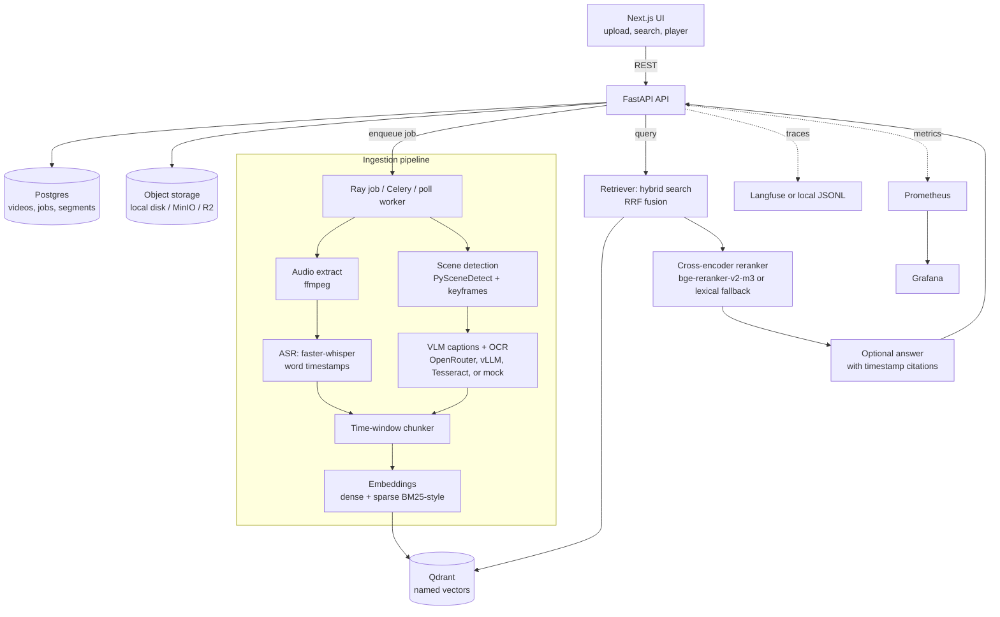
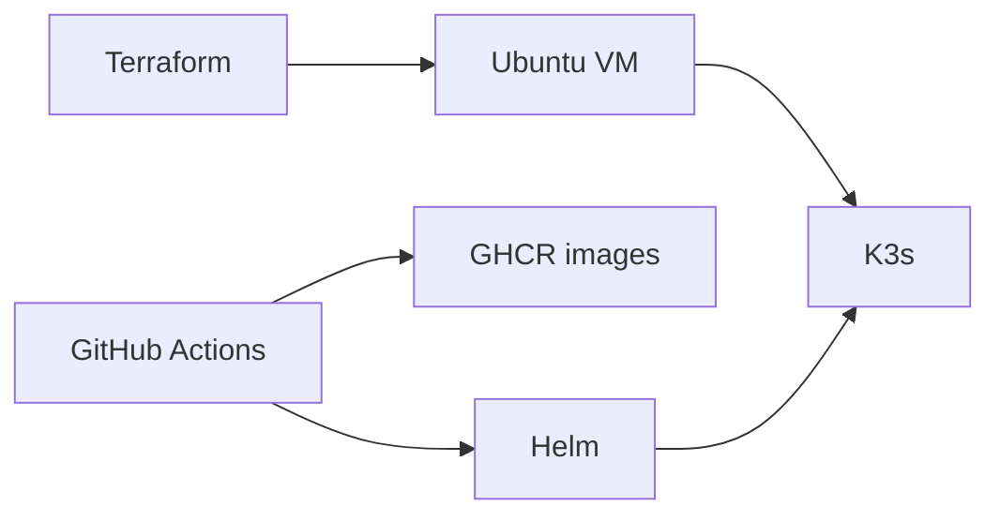

# VideoMind

**Search what a video says and shows—then jump to the matching moment.**


VideoMind is a multimodal video-search application built around timestamped speech, scene keyframes, visual captions, and dense/sparse retrieval. A FastAPI backend indexes searchable segments; a Next.js interface lets users upload videos, follow processing progress, and play results at their source timestamps.

> **In development — core application verified, completion work ongoing.** The CPU demo, search/playback flow, and automated checks have been exercised in GitHub Codespaces. Production deployment, broader evaluation, and a recorded walkthrough remain pending. A private, temporary Codespaces session is not a permanent public demo.

[Quick start](#quick-start) · [Evaluation](#evaluation) · [Architecture](#architecture) · [Codespaces guide](docs/codespaces.md) · [Verification report](docs/cloud-verification.md)

## Capabilities

- **Speech and visual ingestion:** FFmpeg audio extraction, faster-whisper transcription with word timestamps and VAD, scene-based keyframes, OCR, and optional vision-language captions.
- **Hybrid retrieval:** transcript and visual dense vectors plus hashed sparse terms with Qdrant IDF weighting, fused using reciprocal rank fusion.
- **Optional reranking:** a BGE cross-encoder backend and a lightweight lexical fallback; disabled by default based on the small-corpus evaluation below.
- **Timestamped playback:** search results include snippets, keyframes, and time spans; the player seeks to the selected moment.
- **Operational controls:** upload limits, processing states, retries, optional API-key protection, and rate limits.
- **Integration paths:** embedded/server Qdrant, local/S3-compatible/R2 media storage, OpenRouter or vLLM captions, and optional Langfuse tracing.

## Implementation status

| Area | Evidence / status |
|---|---|
| Python checks | 53 unit/integration tests and 1 real Whisper end-to-end test passed in Codespaces on 11 Nov 2026 |
| Web application | ESLint, TypeScript/production build, search, and timestamped playback verified |
| Retrieval evaluation | Historical three-clip BGE and hash comparisons documented below; larger evaluation pending |
| Cloud integrations | Implementation and prior run results documented; integrations have not been revalidated with new credentials during recovery |
| Container / deployment files | Compose configuration validated; full stack, image builds, and production rollout not verified during recovery |
| Hosted release | No permanent public demo or recorded walkthrough published |

See [the verification report](docs/cloud-verification.md) for exact checks and boundaries. GitHub Actions definitions are present, but **Actions is currently disabled**; no continuously passing CI badge is claimed.

## Architecture



A segment is one searchable window: `video_id`, `start_s`, `end_s`, transcript, visual caption, OCR text, and a keyframe. The default window is about 45 seconds with about 10 seconds of overlap, snapped to Whisper sentence boundaries. The 32-second sample clip uses 8-second windows so each slide can be its own hit.

Speech is transcribed with faster-whisper (`vad_filter=True`, word timestamps). PySceneDetect's adaptive detector picks frames where the picture changes, and a frame is also kept at least every 30 seconds before a perceptual-hash check drops a frame that matches the previous one. Captions go through one interface with four backends: OpenRouter, a self-hosted Qwen2.5-VL on vLLM, Tesseract (CPU, no key), or a mock used by the tests. Results are cached by image hash. Dense vectors default to a hashing embedder so the project runs without downloading BGE; set `EMBEDDING_BACKEND=sentence_transformers` and `EMBEDDING_MODEL=BAAI/bge-m3` when you are ready to download it (`EMBEDDING_DIM=1024`, new collection). Sparse vectors are term frequencies on a stable token hash, with Qdrant's IDF modifier. Hybrid search prefetches `text_dense`, `visual_dense`, and `sparse` and fuses them with reciprocal rank fusion. That hybrid, with the reranker off, is the default. `RERANKER_ENABLED` defaults to false: on these short clips the cross-encoder lowered Recall@1 and about doubled CPU latency. Set `RERANKER_BACKEND=cross_encoder` and `RERANKER_ENABLED=true` to load `BAAI/bge-reranker-v2-m3`. The lexical scorer remains available for tests that must not download weights.

## Evaluation

### Scope and provenance

The following are the **reported results from the original 10 Nov 2026 separate-machine run**, retained during repository recovery. They were not regenerated by the 11 Nov Codespaces smoke checks. The aligned query set and scoring implementation are committed; the generated per-run evaluation artifacts are not currently checked in. Treat this as a small-corpus engineering comparison, not a general video-search benchmark.

Measured, 3 clips, 22 test queries, bge-m3 + bge-reranker-v2-m3, CPU, Nov 10 2026. Collection `segments_bge` (12 points, 1024-d). Test split of `eval/queries.cloud.jsonl` (31 rows: 25 test, 6 dev). Three test hard negatives are excluded, which is why `n=22`. Recall@10 is 1.000 for every retriever. No Locust run.

| Retriever | R@1 | R@5 | R@10 | MRR@10 | nDCG@10 |
|---|---|---|---|---|---|
| BM25 (sparse) only | 0.909 | 1.000 | 1.000 | 0.947 | 0.950 |
| Transcript dense only | 0.773 | 1.000 | 1.000 | 0.871 | 0.885 |
| Text + visual dense | 0.682 | 0.955 | 1.000 | 0.799 | 0.832 |
| Hybrid (RRF, all three) | 0.909 | 1.000 | 1.000 | 0.943 | 0.940 |
| Hybrid + cross-encoder | 0.818 | 0.955 | 1.000 | 0.894 | 0.911 |

Search latency on that CPU box, against Qdrant Cloud. Embedding p50 is about 45 ms. The rerank column is the cross-encoder step.

| Retriever | total p50 | total p95 | rerank p50 | rerank p95 |
|---|---|---|---|---|
| Hybrid | 623.8 ms | 648.1 ms | — | — |
| Hybrid + cross-encoder | 1252.3 ms | 1432.1 ms | 653.3 ms | 817.7 ms |

**What the comparison shows:** BGE-m3 improves transcript-dense Recall@1 over hashing (0.682 → 0.773) and hybrid Recall@1 (0.864 → 0.909). Sparse-only matches BGE hybrid at Recall@1 and scores slightly higher on MRR and nDCG; hybrid is not an outright winner on this set. Text-plus-visual trails. The cross-encoder lowers hybrid Recall@1 from 0.909 to 0.818 and roughly doubles median latency. Hybrid without reranking remains the configured default; sparse-only is a strong baseline worth retaining. With only 22 scored queries, these observations should not be generalized to longer videos or larger corpora.

Same aligned file, hashing embedder (384-d, collection `segments`) and the lexical reranker. Sparse matches the BGE sparse row because that path does not use the dense model.

| Retriever | R@1 | R@5 | MRR@10 | nDCG@10 |
|---|---|---|---|---|
| BM25 (sparse) only | 0.909 | 1.000 | 0.947 | 0.950 |
| Transcript dense only | 0.682 | 0.955 | 0.817 | 0.863 |
| Text + visual dense | 0.727 | 1.000 | 0.839 | 0.867 |
| Hybrid (RRF, all three) | 0.864 | 1.000 | 0.924 | 0.929 |
| Hybrid + lexical reranker | 0.818 | 1.000 | 0.890 | 0.908 |

Caption cost was **$0.0020 total across both ingest runs**, model `qwen/qwen3.7-flash`: $0.00177940 for the first 13 captions, then $0.00024852 for the one new Hufsky frame at 29.85s (the 15.05s frame was a cache hit at $0). The BGE re-embed and this eval did not call OpenRouter. The `--max-usd` cap on each ingest was $0.15.

The hit rule, the dev/test split, and the JSONL shape are in [eval/README.md](eval/README.md). `eval/queries.sample.jsonl` has four queries for the synthetic clip. It is a format example. The cloud file is the measured set.

## Quick start

### Recommended: GitHub Codespaces

Open **Code → Codespaces → Create codespace on main**. The [devcontainer configuration](.devcontainer/devcontainer.json) declares Python 3.12, Node 22, and the required system packages. A fresh rebuild of that configuration is still to be verified; the recovery checks ran on the initial Codespaces environment. See the [Codespaces guide](docs/codespaces.md) for setup, ports, secrets, and quota management.

In an existing Codespace that predates the configuration:

```bash
bash .devcontainer/setup.sh
```

Setup installs dependencies in the cloud but **does not automatically download model weights, ingest videos, or call paid APIs**. The script refuses to install outside Codespaces.

### CPU demo: no API keys required

Run from the repository root in your Codespace or Linux cloud workspace. A local Linux environment is optional, not required. Prerequisites: Python 3.11+, Node.js 22, FFmpeg, espeak-ng, Tesseract, and a DejaVu font installation for the generated slides. Python dependencies come from `requirements.txt`; the frontend uses `services/web/package-lock.json`.

```bash
python3 -m venv .venv
.venv/bin/pip install -r requirements.txt
npm --prefix services/web ci
bash scripts/demo.sh
make api
```

From a **second terminal** in the same workspace:

```bash
make web
```

Open port **43123** in the Codespaces Ports panel and keep it **Private**. On a local environment, visit [http://127.0.0.1:43123](http://127.0.0.1:43123). The frontend proxies API requests to port 43124 internally.

Search `architecture diagram` and press **Play this moment**. The player seeks to the result's `start_s`. In the 11 Nov cloud check, the top result began at **16.29 seconds**; ASR output and segment boundaries can vary between runs.

`bash scripts/demo.sh` generates a synthetic lecture, indexes it, and runs three searches. It forces Tesseract, hash embeddings, and the local database/index path. It downloads the tiny Whisper weights **into the environment running the demo**, not into a separate laptop. It does not call paid model APIs. Stop the API before re-running ingestion: two processes cannot open the same embedded Qdrant path.

The paid cloud path (OpenRouter, Qdrant Cloud on port 443, Cloudflare R2 bucket `videomind-media`, Langfuse Cloud) is in [CLOUD_RUN.md](CLOUD_RUN.md). Keys stay in the environment. Caption calls stop at `--max-usd` (default $0.15) using the cost OpenRouter reports.

### Development checks

```bash
make lint
make test
npm --prefix services/web run lint
npm --prefix services/web run build
make e2e
```

`make test` excludes the end-to-end marker; `make e2e` explicitly runs the generated-clip test with actual faster-whisper tiny on CPU. The end-to-end test may download model weights if not cached. The hash embedder used by tests and the demo is not BGE; do not compare its smoke-test timings with the historical BGE/cloud numbers.

### Configuration and secrets

Use [`.env.example`](.env.example) for the full configuration reference. Store real keys in repository-selected Codespaces secrets or an uncommitted `.env`, never in Git or issue attachments.

| Capability | Configuration |
|---|---|
| Default development search | Hash embeddings, embedded Qdrant, SQLite, reranker off |
| BGE embeddings | `EMBEDDING_BACKEND=sentence_transformers`, `EMBEDDING_MODEL=BAAI/bge-m3`, `EMBEDDING_DIM=1024`, new `QDRANT_COLLECTION` |
| Optional cross-encoder | `RERANKER_ENABLED=true`, `RERANKER_BACKEND=cross_encoder` |
| Managed index | `QDRANT_URL`, `QDRANT_API_KEY` |
| R2 media storage | `R2_ACCOUNT_ID`, `R2_ACCESS_KEY_ID`, `R2_SECRET_ACCESS_KEY`, `R2_BUCKET` |
| Paid captioning | `CAPTION_BACKEND=openrouter`, `OPENROUTER_API_KEY` |
| Langfuse tracing | `LANGFUSE_PUBLIC_KEY`, `LANGFUSE_SECRET_KEY`, `LANGFUSE_HOST` |

The BGE and cross-encoder backends require their optional `sentence-transformers` dependency and substantial weight downloads. Set them up in your cloud environment and reindex into a new collection rather than mixing vector dimensions. [CLOUD_RUN.md](CLOUD_RUN.md) explains ingestion, label alignment, and evaluation. Its `--max-usd` guard stops subsequent caption calls at the threshold; an in-flight call can finish slightly above it. Setting a key is not a substitute for a provider-side spending limit.

### Container-based development

Docker Compose (Postgres, Redis, Qdrant, MinIO, API, worker, web, Prometheus, Grafana) is defined in [`deploy/docker-compose.yml`](deploy/docker-compose.yml). Configuration validation passed during recovery; image builds and the running stack are not yet verified. Example MinIO/Postgres credentials are development defaults, not production credentials.

```bash
cp .env.example .env
make up
# upload a video in the UI, or point ingest-sample at the compose endpoints
```

## Infrastructure



`deploy/terraform` can plan a Hetzner VM, a firewall, a Cloudflare DNS record, and an R2 bucket. Every paid resource is behind a flag that defaults to false, so `terraform validate` does not create anything. `deploy/k8s/install-k3s.sh` installs k3s. `deploy/helm/videomind` is the chart (`helm lint` passes): API, web, poll worker, Postgres, Qdrant, an Ingress (class `nginx`, matching `deploy/k8s/install-k3s.sh`, which turns Traefik off), an HPA, and optional ServiceMonitor, KubeRay, and KEDA manifests that stay off until you enable them. The shared data volume is ReadWriteOnce, so this chart is for one node until media moves to S3 or R2.

The included [CI workflow](.github/workflows/ci.yml) defines Python tests, the short end-to-end test, frontend build, Helm lint, and Terraform validation. [The deployment workflow](.github/workflows/deploy.yml) defines GHCR image publication and a Helm rollout gated on `KUBECONFIG_B64`. **Actions is currently disabled.** Review triggers, permissions, image visibility, and spending before enabling either workflow. Infrastructure files are deployment scaffolding, not evidence of a running production cluster.

What you have to create yourself (accounts, keys, the VM) is listed as copy-paste commands in [RUNBOOK.md](RUNBOOK.md).

Prometheus scrapes `/metrics` (request latency, search latency by stage, jobs by state, stage duration, reported model cost). Alert rules cover job failures and search p95. Grafana dashboard JSON is in `monitoring/grafana/`. Caption and answer calls append a JSON line under the data directory and, when `LANGFUSE_PUBLIC_KEY` and `LANGFUSE_SECRET_KEY` are set, are also sent to Langfuse.

## Example queries

On the synthetic sample (four 8-second slides, speech from espeak-ng, titles burned into the frames):

| Kind | Query | Where it should land |
|---|---|---|
| Spoken / slide title | backpropagation | The second slide; ASR may spell it differently, while OCR provides the visible title |
| Visual + spoken | architecture diagram | The architecture slide; top search hit started at 00:16 in the 11 Nov cloud check |
| Keyword | loss function | The final slide; the exact transcript and returned time span depend on the ASR run |

The synthetic clip is an integration fixture, not a representative customer corpus. See [the cloud verification report](docs/cloud-verification.md) for the exercised browser flow. A recorded walkthrough is still pending.

## Limitations

- Accents, overlapping speech, and noisy rooms will hurt the timestamps. There is no speaker diarization.
- A VLM caption can describe a slide that is not there. The cache stores that caption. Tesseract only reads text it can see.
- The default embedder is a hashing trick, not BGE. Keyword overlap works; paraphrase quality will not, until you switch the backend and reindex.
- The reranker is off by default. `bge-reranker-v2-m3` is implemented and was measured; on these short clips it did not beat hybrid. The lexical scorer is what the unit tests run.
- Ray and Celery are implemented and import cleanly. They were not run as a cluster here. The verified worker is the in-process pipeline, with retries per stage.
- Long videos are rejected at `MAX_VIDEO_SECONDS` (default 4 hours) and `MAX_UPLOAD_BYTES` (default 2 GiB). That is a guard, not a scaling story.
- The headline table is 22 scored queries on three short clips. It is not a 150-query set, and it is not a GPU latency number.

## Video sources

`data/manifest.csv` lists the synthetic sample as CC0-style generated media (ffmpeg + espeak-ng). It is not a lecture from MIT or anywhere else. When you add real videos, record the source URL and the license in that file, and only use material you have the right to use.

## Layout

```
services/api          FastAPI
services/pipeline     ASR, scenes, captions, chunking, index, workers
services/web          Next.js UI
eval                  metrics, sample queries, runner, labeling CLI
deploy                compose, Helm, Terraform, k3s
monitoring            Prometheus, alerts, Grafana
```

Decisions are in [NOTES.md](NOTES.md). The interview prompts at the bottom of that file are for you to answer in your own words.

## Roadmap

- [x] Implement ingestion, hybrid retrieval, processing-state APIs, and timestamped playback.
- [x] Exercise CPU integration tests, actual Whisper end-to-end ingestion, and the browser search/playback flow in Codespaces.
- [x] Document the original BGE/hash ablation results and leave reranking optional.
- [ ] Verify a clean devcontainer rebuild and the complete container stack.
- [ ] Expand the licensed corpus and labeled test set; publish reproducible per-run artifacts.
- [ ] Revalidate managed-service integrations and production access controls.
- [ ] Complete deployment and record a walkthrough.

## Contributing, security, and licensing

See [CONTRIBUTING.md](CONTRIBUTING.md) for development and evaluation requirements, [SECURITY.md](SECURITY.md) for reporting concerns, and [the implementation checklist](docs/security.md) for known security boundaries. Keep development ports private until authentication, secrets, network access, and TLS are reviewed.

This repository does not currently include a repository-wide source license. Public visibility alone does not grant a permissive reuse license; contact the author about reuse. Video, model, dataset, and dependency licenses apply independently. The source URLs and attribution requirements for the historical clips are listed in [CLOUD_RUN.md](CLOUD_RUN.md).

## Author

Built by **[Muhammad Saad Khan](https://saad-khan.xyz)**, Applied AI Engineer and founder of **[Stack & Scale](https://stackandscale.org)**, a software house providing web, mobile, desktop, AI-agent, and automation solutions.

[GitHub](https://github.com/saadkhan2003) · [LinkedIn](https://www.linkedin.com/in/saadkhan2003/)
