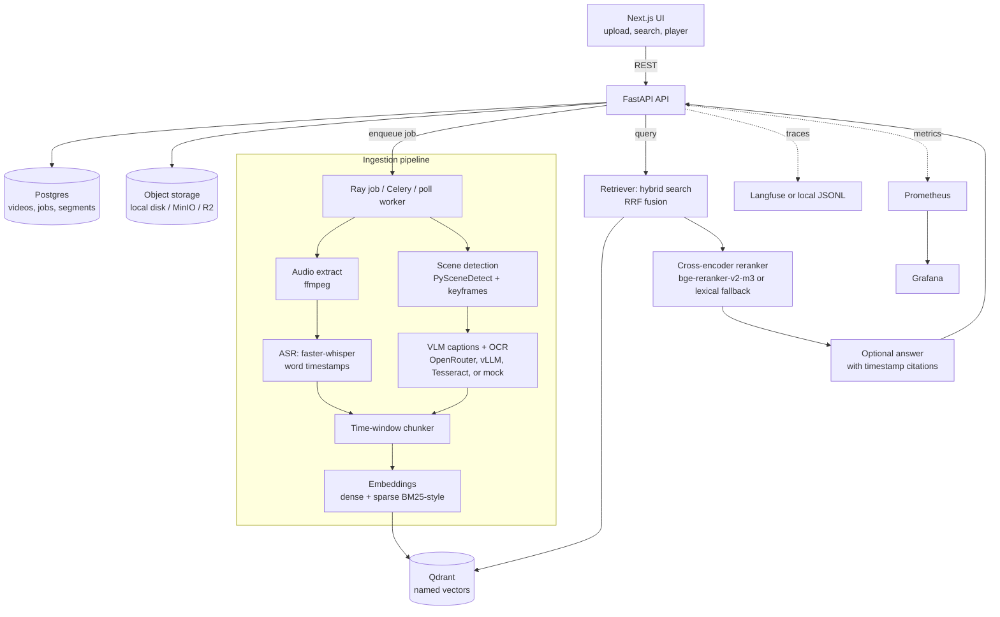
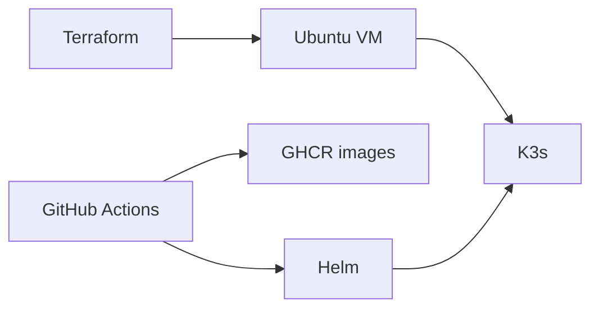

# VideoMind

Ask a question about a lecture, a meeting, or a tutorial. VideoMind returns the moment, and the player starts there.

Portfolio project by Muhammad Saad Khan, aimed at applied AI / ML engineering (multimodal retrieval, evaluation, and the path to a small Kubernetes deploy).

Live demo and a two-minute walkthrough are not recorded yet. Add the links here after you host one.

## Architecture



A segment is one searchable window: `video_id`, `start_s`, `end_s`, transcript, visual caption, OCR text, and a keyframe. The default window is about 45 seconds with about 10 seconds of overlap, snapped to Whisper sentence boundaries. The 32-second sample clip uses 8-second windows so each slide can be its own hit.

Speech is transcribed with faster-whisper (`vad_filter=True`, word timestamps). PySceneDetect's adaptive detector picks frames where the picture changes, and a frame is also kept at least every 30 seconds before a perceptual-hash check drops a frame that matches the previous one. Captions go through one interface with four backends: OpenRouter, a self-hosted Qwen2.5-VL on vLLM, Tesseract (CPU, no key), or a mock used by the tests. Results are cached by image hash. Dense vectors default to a hashing embedder so the project runs without downloading BGE; set `EMBEDDING_BACKEND=sentence_transformers` and `EMBEDDING_MODEL=BAAI/bge-m3` when you are ready to download it (`EMBEDDING_DIM=1024`, new collection). Sparse vectors are term frequencies on a stable token hash, with Qdrant's IDF modifier. Hybrid search prefetches `text_dense`, `visual_dense`, and `sparse` and fuses them with reciprocal rank fusion. That hybrid, with the reranker off, is the default. `RERANKER_ENABLED` defaults to false: on these short clips the cross-encoder lowered Recall@1 and about doubled CPU latency. Set `RERANKER_BACKEND=cross_encoder` and `RERANKER_ENABLED=true` to load `BAAI/bge-reranker-v2-m3`. The lexical scorer remains available for tests that must not download weights.

## Retrieval numbers

Measured, 3 clips, 22 test queries, bge-m3 + bge-reranker-v2-m3, CPU, Nov 10 2026. Collection `segments_bge` (12 points, 1024-d). Test split of `eval/queries.cloud.jsonl` (31 rows: 25 test, 6 dev). Three test hard negatives are excluded, which is why `n=22`. Recall@10 is 1.000 for every retriever. No Locust run.

| Retriever | R@1 | R@5 | R@10 | MRR@10 | nDCG@10 |
|---|---|---|---|---|---|
| BM25 (sparse) only | 0.909 | 1.000 | 1.000 | 0.947 | 0.950 |
| Transcript dense only | 0.773 | 1.000 | 1.000 | 0.871 | 0.885 |
| Text + visual dense | 0.682 | 0.955 | 1.000 | 0.799 | 0.832 |
| Hybrid (RRF, all three) | 0.909 | 1.000 | 1.000 | 0.943 | 0.940 |
| Hybrid + cross-encoder | 0.818 | 0.955 | 1.000 | 0.894 | 0.911 |

Search latency on that CPU box, against Qdrant Cloud. Embedding p50 is about 45 ms. The rerank column is the cross-encoder step.

| Retriever | total p50 | total p95 | rerank p50 | rerank p95 |
|---|---|---|---|---|
| Hybrid | 623.8 ms | 648.1 ms | — | — |
| Hybrid + cross-encoder | 1252.3 ms | 1432.1 ms | 653.3 ms | 817.7 ms |

BGE-m3 lifts the dense and hybrid rows over the hashing embedder on this same file (transcript-dense Recall@1 0.682 → 0.773, hybrid 0.864 → 0.909). Hybrid is the best overall: it matches sparse at Recall@1 0.909, keeps Recall@5 and Recall@10 at 1.000, and has the highest nDCG of the runs that use the dense vectors (0.940). Text-plus-visual trails. The cross-encoder does not help at this scale. It drops hybrid Recall@1 from 0.909 to 0.818 and Recall@5 from 1.000 to 0.955, and it about doubles latency (623.8 ms to 1252.3 ms p50), with 653.3 / 817.7 ms of that inside the rerank step. For these short clips the default is hybrid with the reranker off.

Same aligned file, hashing embedder (384-d, collection `segments`) and the lexical reranker. Sparse matches the BGE sparse row because that path does not use the dense model.

| Retriever | R@1 | R@5 | MRR@10 | nDCG@10 |
|---|---|---|---|---|
| BM25 (sparse) only | 0.909 | 1.000 | 0.947 | 0.950 |
| Transcript dense only | 0.682 | 0.955 | 0.817 | 0.863 |
| Text + visual dense | 0.727 | 1.000 | 0.839 | 0.867 |
| Hybrid (RRF, all three) | 0.864 | 1.000 | 0.924 | 0.929 |
| Hybrid + lexical reranker | 0.818 | 1.000 | 0.890 | 0.908 |

Caption cost was **$0.0020 total across both ingest runs**, model `qwen/qwen3.7-flash`: $0.00177940 for the first 13 captions, then $0.00024852 for the one new Hufsky frame at 29.85s (the 15.05s frame was a cache hit at $0). The BGE re-embed and this eval did not call OpenRouter. The `--max-usd` cap on each ingest was $0.15.

The hit rule, the dev/test split, and the JSONL shape are in [eval/README.md](eval/README.md). `eval/queries.sample.jsonl` has four queries for the synthetic clip. It is a format example. The cloud file is the measured set.

## Run locally

For cloud-only development without laptop installs, use the
[Codespaces guide](docs/codespaces.md). The cloud setup installs dependencies but
does not automatically download model weights or call paid APIs.

CPU path, no Docker, no API keys. This is the path that was run in the build environment.

```bash
python3 -m venv .venv
.venv/bin/pip install -r requirements.txt
# ffmpeg, espeak-ng, and tesseract are required for the sample clip
make ingest-sample
make api          # http://127.0.0.1:43124
make web          # http://127.0.0.1:43123
```

Open the UI, search for a word from the sample lecture (for example `backpropagation` or `architecture`), and press **Play this moment**. The player seeks to `start_s`.

`./scripts/demo.sh` is that same CPU path in one command: synthetic clip, index, three searches. It forces Tesseract, the hash embedder, and the local database so a `.env` full of cloud keys is not used and nothing is billed.

The paid cloud path (OpenRouter, Qdrant Cloud on port 443, Cloudflare R2 bucket `videomind-media`, Langfuse Cloud) is in [CLOUD_RUN.md](CLOUD_RUN.md). Keys stay in the environment. Caption calls stop at `--max-usd` (default $0.15) using the cost OpenRouter reports.

`make test` runs the unit and integration tests. `make e2e` rebuilds the synthetic clip and runs faster-whisper tiny on CPU.

Docker Compose (Postgres, Redis, Qdrant, MinIO, API, worker, web, Prometheus, Grafana) is in `deploy/docker-compose.yml`. `make up` was not executed here because this environment has no Docker daemon. Local MinIO and Postgres passwords in that file are for a laptop only.

```bash
cp .env.example .env
make up
# upload a video in the UI, or point ingest-sample at the compose endpoints
```

## Infrastructure



`deploy/terraform` can plan a Hetzner VM, a firewall, a Cloudflare DNS record, and an R2 bucket. Every paid resource is behind a flag that defaults to false, so `terraform validate` does not create anything. `deploy/k8s/install-k3s.sh` installs k3s. `deploy/helm/videomind` is the chart (`helm lint` passes): API, web, poll worker, Postgres, Qdrant, an Ingress (class `nginx`, matching `deploy/k8s/install-k3s.sh`, which turns Traefik off), an HPA, and optional ServiceMonitor, KubeRay, and KEDA manifests that stay off until you enable them. The shared data volume is ReadWriteOnce, so this chart is for one node until media moves to S3 or R2.

GitHub Actions (`.github/workflows/ci.yml`) lints, runs the unit tests and the short end-to-end test, builds the UI, lints the chart, and validates Terraform. `deploy.yml` pushes images to GHCR and runs `helm upgrade` when `KUBECONFIG_B64` is set. Roll back with `helm rollback videomind`.

What you have to create yourself (accounts, keys, the VM) is listed as copy-paste commands in [RUNBOOK.md](RUNBOOK.md).

Prometheus scrapes `/metrics` (request latency, search latency by stage, jobs by state, stage duration, reported model cost). Alert rules cover job failures and search p95. Grafana dashboard JSON is in `monitoring/grafana/`. Caption and answer calls append a JSON line under the data directory and, when `LANGFUSE_PUBLIC_KEY` and `LANGFUSE_SECRET_KEY` are set, are also sent to Langfuse.

## Example queries

On the synthetic sample (four 8-second slides, speech from espeak-ng, titles burned into the frames):

| Kind | Query | Where it should land |
|---|---|---|
| Spoken / slide title | backpropagation | about 00:07 on the sample. Tiny Whisper heard the synthetic voice as "back in the application"; the hit is the slide whose OCR text is "Backpropagation". |
| Visual | architecture diagram | about 00:15, from the burned-in title read by Tesseract |
| Keyword | loss function | about 00:22, again from the slide title. "mean squared error" is in the script but was not in the tiny-model transcript |

Screenshots belong in the demo video you record. None are checked in, so this README does not pretend a UI session that was not captured.

## Limitations

- Accents, overlapping speech, and noisy rooms will hurt the timestamps. There is no speaker diarization.
- A VLM caption can describe a slide that is not there. The cache stores that caption. Tesseract only reads text it can see.
- The default embedder is a hashing trick, not BGE. Keyword overlap works; paraphrase quality will not, until you switch the backend and reindex.
- The reranker is off by default. `bge-reranker-v2-m3` is implemented and was measured; on these short clips it did not beat hybrid. The lexical scorer is what the unit tests run.
- Ray and Celery are implemented and import cleanly. They were not run as a cluster here. The verified worker is the in-process pipeline, with retries per stage.
- Long videos are rejected at `MAX_VIDEO_SECONDS` (default 4 hours) and `MAX_UPLOAD_BYTES` (default 2 GiB). That is a guard, not a scaling story.
- The headline table is 22 scored queries on three short clips. It is not a 150-query set, and it is not a GPU latency number.

## Video sources

`data/manifest.csv` lists the synthetic sample as CC0-style generated media (ffmpeg + espeak-ng). It is not a lecture from MIT or anywhere else. When you add real videos, record the source URL and the license in that file, and only use material you have the right to use.

## Layout

```
services/api          FastAPI
services/pipeline     ASR, scenes, captions, chunking, index, workers
services/web          Next.js UI
eval                  metrics, sample queries, runner, labeling CLI
deploy                compose, Helm, Terraform, k3s
monitoring            Prometheus, alerts, Grafana
```

Decisions are in [NOTES.md](NOTES.md). The interview prompts at the bottom of that file are for you to answer in your own words.
